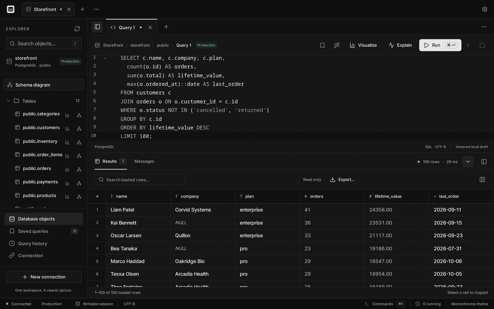

# Quarro

<picture>
  <source media="(prefers-color-scheme: light)" srcset="docs/media/hero.light.webp">
  
</picture>

Quarro is a desktop database client for Linux, macOS and Windows that isn't tied to one engine, each database plugs in as a provider and shows up the way it actually works, SQL as tables, documents as documents, keys as keys. PostgreSQL, MySQL, SQLite, MongoDB and Redis ship today. More on **[quarro.io](https://quarro.io)**.

## install

Grab a file from [releases](https://github.com/yazeed1s/quarro/releases), `.dmg` for macOS, setup `.exe` for Windows, and AppImage, `.deb` or `.rpm` on Linux. Read [docs/install.md](docs/install.md) before you give up on any issue you might run into.

## build from source

You need Go 1.25+, Node 24 and the Wails v3 CLI pinned to the same beta the app uses:

```sh
go install github.com/wailsapp/wails/v3/cmd/wails3@v3.0.0-beta.22
```

On Linux you also need GTK 4 and WebKitGTK 6.0 headers (`sudo apt install build-essential pkg-config libgtk-4-dev libwebkitgtk-6.0-dev` on Ubuntu 24.04+ or Debian 13, other distros have the same packages under similar names). macOS wants the Xcode command line tools, Windows uses WebView2 which is already there on 10 and 11 I think.

```sh
wails3 task dev        # hot reload, vite on :9245
wails3 task build      # binary in bin/quarro
wails3 task package    # dmg / nsis installer / appimage+deb+rpm for your OS
```

`GOOS=...` picks another target OS, and on Linux the build goes through Docker if you're cross compiling (`wails3 task setup:docker` first, it's a ~800MB image). There is also a server mode that serves the same UI over plain HTTP without any native GUI, `wails3 task build:server` and `wails3 task run:server`, I mostly use it for headless test runs, not sure it's useful for anyone else yet.

For a database to point it at, `dev/docker-compose.yml` brings up seeded PostgreSQL, MySQL, MongoDB and Redis:

```sh
docker compose -f dev/docker-compose.yml up -d --wait
```

ports and passwords are in [docs/testing.md](docs/testing.md).

## tests

```sh
go test ./internal/...              # unit tests, engine contract tests skip themselves
scripts/test-engine.sh all          # real postgres, mysql, mariadb, mongo, redis in throwaway containers
cd frontend && npm run check && npm run test:unit
```

The contract tests never use mocks, they run against a real server in Docker that the script deletes when it's done. How that works is in [docs/testing.md](docs/testing.md).

## docs

[docs/install.md](docs/install.md) for installing and getting past the unsigned-app warnings, [docs/testing.md](docs/testing.md) for the test containers and the dev databases, [docs/providers.md](docs/providers.md) if you want to add a sixth engine, and [docs/contributing.md](docs/contributing.md) before sending a PR.

## layout

```
main.go                 wails app, registers every engine
internal/app/           services the frontend calls
internal/sessions/      connection pools, pinned per-document connections
internal/database/      capability interfaces, driver registry, one package per engine
internal/connections/   saved profiles (secrets live in internal/secrets, separate)
frontend/               svelte 5 + codemirror + svelteflow
build/                  per-OS taskfiles and packaging
dev/                    seeded docker compose for poking at it by hand
scripts/test-engine.sh  disposable databases for tests
```
